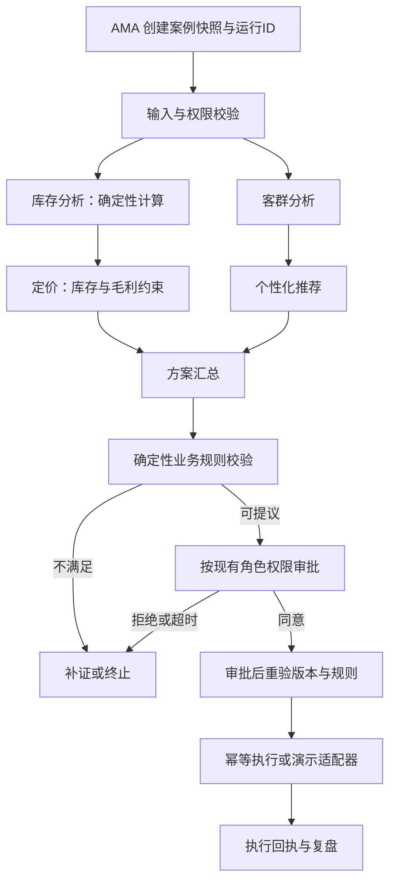

# AMA：Agent Framework + Durable 设计草案

状态：待评审；仅设计，没有创建、部署或修改Azure资源。
日期：2026-11-03。面向Azure全球版。

## 1. 目标与范围

保留AMA的业务案例、角色权限、审批、执行和复盘。替换进程内顺序编排，获得真实的依赖图、可恢复运行、人工审批等待、阶段性结果和成本记录。不承诺实现拖拽编辑器：首版是代码定义图、页面观察图；可视化编辑是单独能力。

当前代码核验：RetailScenarioEngine._run_state按顺序调用五个领域模块，通过state传递结果。BaseAgent.send_message未接通传输，send_and_wait是mock。不得把它们包装成已接通A2A。
当前资源只读核验：ca-amaretailreview-api，日本东区，0.5vCPU / 1GiB，minReplicas=1、maxReplicas=5。该观察不是费用账单，未改配置。

## 2. 首版部署选择

- AMA UI和FastAPI继续位于现有Container Apps。
- 新增一个Azure Functions Flex Consumption应用，always-ready为0（部署时确认SKU、区域、配额及SDK兼容性）。
- Functions承载Agent Framework Durable Extension工作流，使用Durable Task Scheduler Consumption作为持久化后端。
- 首版选择这一种受支持的持久化集成，不同时自建第二套流程状态机。若目标区域/语言版本不支持，先报告差异再确定替代路线，不静默启用Dedicated或跨区域部署。
- 继续使用现有模型部署及Cosmos DB；必要时新增独立容器/分区配置，但不新增第二个数据库账户。
- 复用现有可观测性服务，新增工作流correlation属性。不开AKS、不加GPU、Redis、Service Bus或APIM。
- 服务间Managed Identity / Entra认证，最小RBAC，不把模型密钥给浏览器。

## 3. 业务流程与依赖

Agent不是必须调用LLM的同义词。库存、金额、权限、阈值和最终执行规则保留代码实现。首个试点只接一个“库存积压案例”，原有路径保留。并行执行前确认读写集：分支读取同一不可变快照，分别返回结构化结果，由汇合步骤合并，不共享可变字典并发写入。

## 4. 三层职责

1. Agent Framework：类型化领域executor、依赖边、条件路由及结构化输出。
2. Durable执行：工作流检查点、调度、恢复、计时器及审批外部事件。图通过官方Durable集成运行，不在外面再包一套自制恢复状态机。
3. AMA：业务案例、角色授权、审批记录、业务执行及面向客户的界面。

LLM调用、HTTP请求、数据库写入等非确定性操作置于适当的activity/executor边界，不能直接放入需要确定性回放的orchestrator代码。具体SDK API需实施时用固定版本的小样验证；本草案不声称已有可运行集成。

## 5. 数据契约

- Run：run_id、case_id、case_version、workflow_version、snapshot_ref、status、created_at、cost_summary。
- NodeResult：node_id、attempt、input_refs、output_ref、evidence_refs、started_at、finished_at、status、model_deployment（如调用）、token_usage、error_code。
- Approval：approval_id、case_version、proposal_hash、requested_role、deadline、decision、actor_id。
- Action：action_id、idempotency_key、approved_proposal_hash、request_hash、downstream_receipt、status。

Durable存执行进度；Cosmos存业务案例、授权后的审批、提案与执行账。大文件/长文本以引用传递，避免在每个检查点重复保存。Scheduler历史最长保留期不替代长期业务审计；按业务需要制定单独保留策略。

审批后校验case_version及关键事实：库存、价格或方案发生变化则重新评估，旧审批不得授权新方案。外部事件必须经AMA后端验证身份、权限、版本及幂等后发送；不能让浏览器直接触发任意run。

## 6. 页面与API

- POST /api/v1/cases/{id}/workflow-runs：授权后创建，返回run_id和查询地址，幂等接受重复提交。
- GET /api/v1/workflow-runs/{run_id}：返回经授权过滤的节点状态、时间、输出摘要及错误。
- POST /api/v1/workflow-runs/{run_id}/approvals/{approval_id}：业务侧授权和版本校验，再发布Durable外部事件。
- 首版页面仅运行中轮询状态，例如每3秒；后台不可每次状态查询都重启编排。不轮询模型生成审批结果。
- 同一页面展示真实的未开始、运行中、等待审批、重试中、成功、失败、拒绝、过期状态；点击节点看输入证据和输出，不展示或索取模型隐藏思维链。
- 业务视图默认简洁，技术trace在详情内；页面没有Dify式拖拽编辑器。

## 7. 恢复、重试与执行安全

- 模型限流/网络暂错：有退避的有限重试；每个节点独立限时和token预算。
- 数据不足或业务规则不通过：返回补证/终止，不无意义重试。
- 审批等待通过持久化事件与计时器，等待期间不维持一个计算请求；现有AMA常驻副本的基础计费并不会因此消失。
- 已完成并持久化的模型结果在正常回放中复用；模型调用后、结果落盘前失败仍可能再次调用，不能承诺绝不重复计费。
- 调拨/发券等执行采用幂等键及业务账，下游支持时传递幂等键；不支持时采用对账与补偿，不能声称exactly-once。
- 原有演示适配器不得改称生产ERP执行。

## 8. 成本模型与限制

增量月费 = 新增Functions计算 + Scheduler派发actions + Cosmos增量读写/存储 + 日志增量 + 模型调用增量 + 可能的网络费用。

- Agent Framework SDK无独立按Agent许可费；模型、工具和托管资源另计。
- Scheduler Consumption无基础费，按派发actions计费；不是按页面节点数简单计价。Dedicated有固定CU费用，首版不选。
- Functions Flex按使用计费，always-ready=0，避免新增预热基线；仍有依赖存储等费用，不保证账单为0。免费额度是否可用取决于订阅内其他应用消耗。
- 不改变现有0.5vCPU/1GiB最少1副本的AMA基线；不能把它计算成新增资源。
- 不新增模型节点为默认策略。第一阶段只重构编排；规则仍用代码。模型调用次数、上下文长度与重试率必须单独测量。

容量示例（假设，不是实测或报价）：每月1000次案例，每次20—40个Scheduler actions，产生2万—4万个actions。若区域每百万actions单价为P，则Scheduler费用为0.02P—0.04P；计算、模型和其他项另加。后续以真实trace计数校准，而不是以五个Agent乘固定系数。

模型量示例（只说明token规模）：若每次新增一次3000输入/500输出token的总结调用，1000次/月会新增300万输入、50万输出token；按选定模型实际输入/输出价分别计算。若不新增调用，则不存在这一项增长。

本次官方价格页未返回可核对的区域数值，Retail Prices按Azure Functions/Action查询也未匹配条目；不能据此认为服务免费。本方案不编造美元/月或人民币/月总价。需选定区域、SDK、部署模型和试跑用量后给出正式估算。

控制措施：单run模型调用上限、token上限、重试上限、并发上限及运行时长限制；日志采样和保留上限。Azure预算告警不是硬停机，应另做应用级额度门禁。预算数额待用户确认，本次未设置任何费用限制或创建预算。

## 9. 实施与验收门槛

1. 本地/隔离测试：固定SDK版本，验证图、并行隔离、节点输入输出及费用计数。
2. 影子试跑：新旧同一案例比较，首版禁止真实写业务系统；观察正确性、时延、token与actions。
3. 恢复验收：中途重启、限流、重复点击、重复审批事件、审批过期、案例变更以及写操作重试。
4. 页面验收：节点状态来自实际执行；等待审批刷新/重启可恢复；权限隔离且不泄露其他案例。
5. 小流量切换：明确用户授权部署后创建按量资源；保留旧编排开关及回退点，不把代码失败等同自动重走业务动作。

首版成功标准：建议与既有规则一致、真实运行可观测、审批等待可恢复、重复执行不重复产生业务动作，并有单次费用台账。

## 官方依据（2026-11-03访问）

- https://learn.microsoft.com/en-us/azure/durable-task/scheduler/durable-task-scheduler-billing
- https://learn.microsoft.com/en-us/agent-framework/hosting/durable-extension
- https://learn.microsoft.com/en-us/azure/durable-task/sdks/durable-task-for-ai-agents
- https://azure.microsoft.com/en-us/pricing/details/functions/

仅使用公开资料及只读配置，不包含凭据、连接串或客户私有数据。

## Implemented pilot

The isolated runtime pilot and its dated acceptance/limitations are in `../../workflow_lab/README.md` and `../../workflow_lab/ACCEPTANCE.md`. This proposal is not proof that the original AMA production app was migrated.
